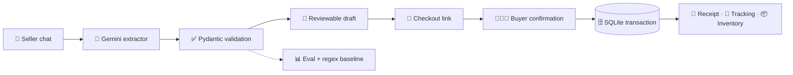
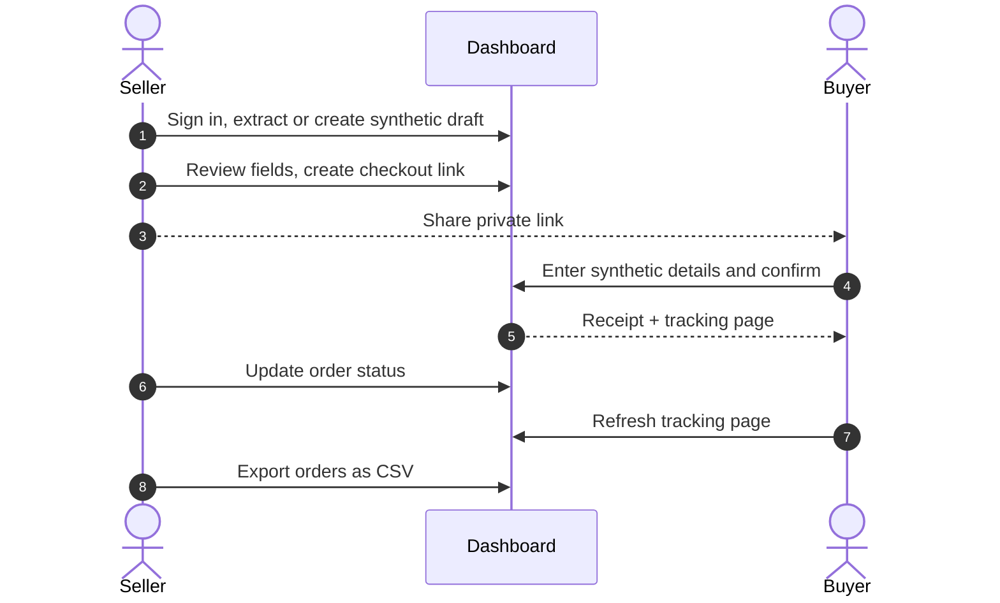

<div align="center">

# 🛒 F-Commerce Order Extractor

**Turn messy Bangla, Banglish & English seller chats into clean, reviewable orders.**

Validated Gemini extraction · deterministic regex baseline · FastAPI + SQLite backend · seller & buyer mobile workflows

<br />


[**Features**](#-features) ·
[**How it works**](#-how-it-works) ·
[**Quick start**](#-quick-start) ·
[**API**](#-cli--api) ·
[**Evaluation**](#-evaluation) ·
[**Roadmap**](#-roadmap)

</div>

<br />

> [!NOTE]
> **Portfolio status:** the complete local MVP is implemented and covered by 241 offline tests. Live Gemini accuracy is **not yet measured**: the recorded evaluation run hit provider failures/quota. The manual checkout flow works without Gemini.

<!--
  📸 Add a screenshot or demo GIF here once you have one:
  <div align="center"></div>
-->

---

## ✨ Features

| | Feature | Details |
|---|---|---|
| 🤖 | **AI extraction** | Pulls `is_order`, customer name, phone, address, product, quantity, notes, and warnings from raw chat text |
| 🔢 | **Smart normalization** | Converts Bangla digits, validates Bangladeshi phone numbers, never invents missing data |
| 📝 | **Reviewable drafts** | Saves drafts to SQLite; sellers review AI output or create drafts manually |
| 🔗 | **Private checkout links** | Buyers confirm delivery details once and get a receipt plus a private tracking page |
| 📦 | **Order operations** | Status updates, courier references, product variants, and stock changes |
| 📤 | **Safe CSV export** | Exports seller-owned orders with formula-like text neutralized |
| 📊 | **Built-in evaluation** | Exact field/order accuracy on a 50-message synthetic dataset, Gemini vs. regex baseline |
| 🔒 | **Seller auth** | Bearer key or browser session on all seller routes |

> All committed examples and test fixtures are **synthetic**. `.env`, SQLite databases, and backups are ignored by Git.

---

## 🧭 How it works



<details>
<summary><b>📁 Project structure</b></summary>

<br />

| Path | Purpose |
|---|---|
| `backend/app/` | Extraction, normalization, API, auth, checkout, inventory, backup, and serving code |
| `backend/tests/` | Offline unit, integration, security, persistence, and workflow tests |
| `frontend/` | Responsive seller dashboard and buyer checkout/tracking pages |
| `eval/` | Synthetic dataset, evaluator, regex baseline, and saved reports |

</details>

---

## 🚀 Quick start

<details open>
<summary><b>🐍 Option A: Run locally with Python 3.11+</b></summary>

<br />

```powershell
python -m venv .venv
.\.venv\Scripts\python.exe -m pip install -r requirements.txt
Copy-Item .env.example .env
```

Edit `.env`: choose a current Gemini model, add the provider API key, and create a seller key. The seller key is **separate** from the Gemini key:

```powershell
python -c "import secrets; print(secrets.token_urlsafe(32))"
```

Add the result as JSON, for example:

```env
SELLER_API_KEYS={"generated-long-key":"local-shop"}
```

Then start the app:

```powershell
.\.venv\Scripts\python.exe -m uvicorn app.main:app --app-dir backend --host 127.0.0.1 --port 8000
```

Open **http://127.0.0.1:8000/** for the seller dashboard or **/docs** for the API.

> [!TIP]
> Extraction needs Gemini settings. Manual drafts and checkout work without them.

</details>

<details>
<summary><b>🐳 Option B: Run with Docker Compose</b></summary>

<br />

Keep provider settings in the ignored `.env`, then set the seller mapping for Compose and start the app:

```powershell
$env:SELLER_API_KEYS = '{"generated-long-key":"local-shop"}'
docker compose up --build
```

Open **http://127.0.0.1:8000/**. SQLite data is kept in the `order-data` named volume.

> [!WARNING]
> Stop with `docker compose down`. Do **not** add `--volumes` if you want to keep your orders.

</details>

---

## 🔌 CLI & API

Extract one synthetic message from the command line:

```powershell
$env:PYTHONPATH = "backend"
.\.venv\Scripts\python.exe -X utf8 -m app.extractor "TEST_PRODUCT 2 ta chai"
```

| Area | Endpoints |
|---|---|
| **Extraction** | `POST /extract` · `POST /extract/batch` |
| **Orders** | `GET /orders` · `GET /orders/export.csv` |
| **Seller** | Draft, checkout, and catalog routes (bearer key or browser session) |
| **Buyer** | Public tokenized checkout and tracking routes |

📖 Full workflow: [BACKEND_CHECKOUT.md](BACKEND_CHECKOUT.md) · 📦 Stock behavior: [INVENTORY.md](INVENTORY.md)

---

## 🎬 Demo flow



---

## 🧪 Tests

```powershell
.\.venv\Scripts\python.exe -m pytest -q
```

GitHub Actions runs the offline suite on **Python 3.11** and **3.12**.

---

## 📊 Evaluation

```powershell
.\.venv\Scripts\python.exe -X utf8 eval/run_eval.py --extractor regex
.\.venv\Scripts\python.exe -X utf8 eval/run_eval.py
```

> The live evaluator requires Gemini credentials and consumes provider quota.

| Extractor | Exact whole order | Mean field | Extraction errors |
| --- | ---: | ---: | ---: |
| 🔤 Regex baseline | **46.00%** (23/50) | **83.43%** | 0 |
| 🤖 Gemini | *Not measured* | *Not measured* | Recorded run failed all 50 requests |

See [results-baseline.md](eval/results-baseline.md) for baseline failures and [results-first.md](eval/results-first.md) for the unsuccessful provider run. Matching `null` values count as correct, so individual failures matter alongside aggregate scores.

---

## 🛡️ Extraction guarantees

- 🚫 The prompt explicitly forbids guessing names, phones, addresses, or other missing fields.
- ❓ Missing quantity is `null`, never an assumed `1`.
- 🗂️ Non-orders return `is_order=false` and null order fields.
- 🔢 Bangla digits are converted to English digits.
- 📱 Phones are stripped of spaces/dashes, `+880`/`880` becomes `0`, and only `^01[3-9]\d{8}$` is accepted.
- ⚠️ Invalid phones become `null` and add a warning; malformed model JSON is retried once.
- 📏 Oversized extraction batches and order text are rejected before provider or storage work.
- 🧼 CSV exports neutralize formula-like user text before it reaches spreadsheet software.

---

## 🗺️ Roadmap

**Done**
- [x] Gemini extraction with Pydantic validation and one retry on malformed JSON
- [x] Regex baseline + 50-message synthetic evaluation set
- [x] Seller dashboard, private checkout links, receipts, and tracking
- [x] Inventory, product variants, and CSV export
- [x] Docker Compose setup with persistent volume
- [x] CI on Python 3.11 and 3.12

**Next**
- [ ] Measure live Gemini accuracy once provider access/quota is available
- [ ] Hosting and a real-user pilot (see [DEPLOYMENT.md](DEPLOYMENT.md))
- [ ] Saved buyer addresses/accounts
- [ ] Courier API and Messenger automation

<details>
<summary><b>⚠️ Current limits</b></summary>

<br />

- Successful live Gemini accuracy still needs to be measured.
- SQLite is intentionally configured for one app instance/worker, not horizontal scaling.
- Courier details and order statuses are seller-entered; there is no courier API or Messenger automation.
- Saved buyer addresses/accounts are not implemented.
- Hosting and a real-user pilot are not complete. The Docker image and persistent local volume have been verified; [DEPLOYMENT.md](DEPLOYMENT.md) documents recovery and optional hosting preparation.

</details>

---

<div align="center">

For implementation history and clearly separated later work, see [EXECUTION_PLAN.md](EXECUTION_PLAN.md).

<sub>Built for Bangladeshi F-commerce sellers · All data in this repo is synthetic</sub>

</div>
